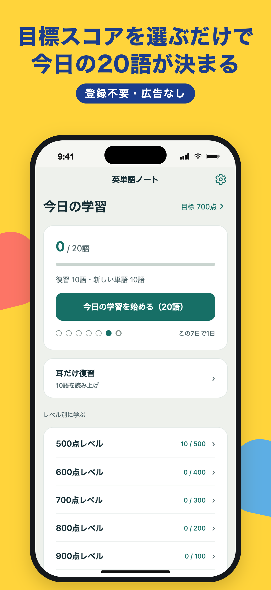
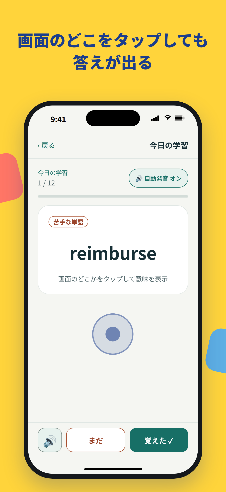
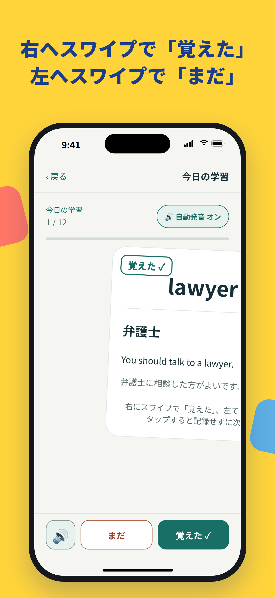
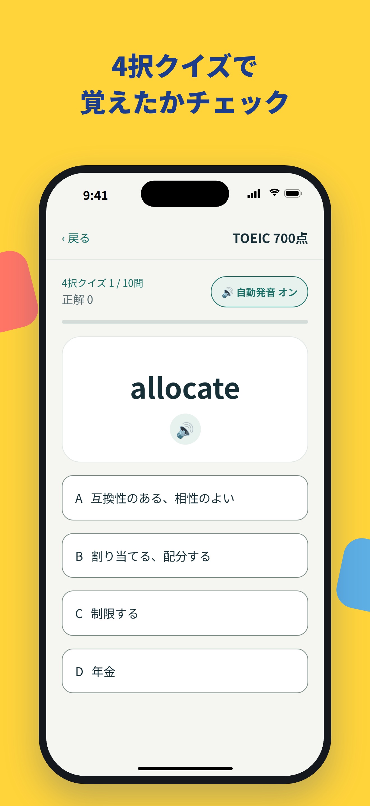
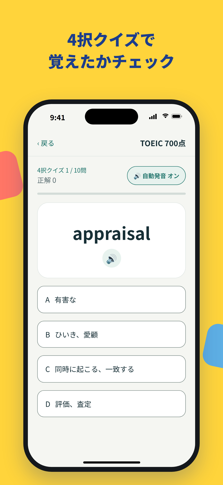
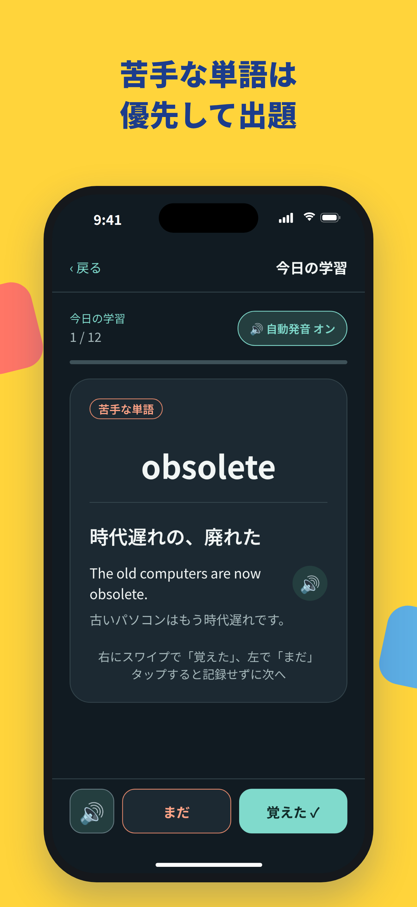

# App Store 掲載情報

App Store Connect に入力する文章とスクリーンショットをまとめています。各項目はそのままコピーして貼り付けられます（文字数はすべて上限内）。

## App の基本情報（新規 App 作成時）

| 項目 | 入力内容 |
| --- | --- |
| プラットフォーム | iOS |
| 名前 | 英単語ノート |
| プライマリ言語 | 日本語 |
| バンドル ID | com.eitangonote.app |
| SKU | eitangonote-ios |
| ユーザアクセス | アクセス制限なし |

`eas submit` を実行すると、App がまだなければ自動で作られます。その場合はこの表の入力は不要です。

## 名前・サブタイトル（App 情報）

- **名前**（30文字以内）: `英単語ノート`
- **サブタイトル**（30文字以内）: `TOEIC®対策 目標スコア別1500語`
  - 商標を名前以外にも出したくない場合の代案: `目標スコア別 ビジネス英単語1500`

## カテゴリ・年齢・価格・配信地域

| 項目 | 入力内容 |
| --- | --- |
| プライマリカテゴリ | 教育 |
| セカンダリカテゴリ | 辞書／辞典／その他（任意） |
| 年齢制限 | 質問にはすべて「なし／いいえ」→ 4+ |
| 価格 | 無料（基準となる国は日本、¥0） |
| 配信地域 | 「特定の国または地域」を選び、EU の27か国を外す |
| Apple シリコン搭載 Mac・Apple Vision Pro での配信 | オフ（動作を確かめていないため） |
| コンテンツ配信権 | 「第三者のコンテンツを含まない」（単語データは自作） |

EU で配信するには、デジタルサービス法にもとづくトレーダー申告が必要です。トレーダーとして申告すると住所と電話番号が EU のストアに公開されるため、EU では配信しません。外す27か国は、アイルランド、イタリア、エストニア、オーストリア、オランダ、キプロス、ギリシャ、クロアチア、スウェーデン、スペイン、スロバキア、スロベニア、チェコ共和国、デンマーク、ドイツ、ハンガリー、フィンランド、フランス、ブルガリア、ベルギー、ポーランド、ポルトガル、マルタ、ラトビア、リトアニア、ルーマニア、ルクセンブルグです（アイスランド、ノルウェー、スイス、イギリスなどは EU ではないので外しません）。

## URL

| 項目 | URL |
| --- | --- |
| プライバシーポリシー URL | https://toeic-app.trainer-jonny.workers.dev/privacy.html |
| サポート URL | https://toeic-app.trainer-jonny.workers.dev/support.html |
| マーケティング URL（任意） | https://toeic-app.trainer-jonny.workers.dev |

## App のプライバシー

「データを収集していません」を選びます。

- 学習の記録と設定は端末の中（AsyncStorage）にだけ保存し、外部に送信しません。
- 発音は iOS 標準の音声合成を使い、通信はしません。
- 広告・解析ツール・アカウント登録はありません。

## プロモーション用テキスト（170文字以内）

審査なしでいつでも書き換えられる欄です。

```
レベルに合った単語をサクッと学び、左右のスワイプで記録できる単語カード。苦手な単語を優先して出し、覚えた単語も忘れたころに復習。発音と例文の自動読み上げで、通勤中のすき間時間にも覚えられます。
```

## 説明（4,000文字以内）

```
英単語ノートは、TOEIC® Listening & Reading テストのスコアアップを目指す人のための英単語アプリです。目標スコアを選ぶだけで、今日覚える20語が自動で決まります。

■ 今日の学習
目標スコア（500〜900点）に合わせて、1日20語の学習メニューをおまかせで作ります。苦手な単語、しばらく見ていない単語の復習、新しい単語をバランスよく出題します。

■ 苦手な単語を優先
「まだ」を選んだ単語や、クイズで間違えた単語は、次から優先して出題されます。覚えた単語も、時間がたつと復習に出てきます。

■ タップとスワイプで、片手でさくさく
カードの上でも下でも、画面のどこをタップしても答えが表示されます。覚えた単語は右へ、まだの単語は左へスワイプするだけで記録できます。同じ操作のボタンも親指が届く画面の下にあるので、電車の中でも片手で使えます。

■ 発音と例文を自動で読み上げ
単語を表示すると発音が流れ、答えを開くと例文も読み上げます。イヤホンをつければ、耳でも覚えられます。自動発音は1回のタップでオフにできます。

■ 4択クイズ
英単語を見て、正しい意味を4つの中から選ぶクイズで、覚えたかどうかを確かめられます。

■ 日本語から英語も
日本語訳を見て英単語を思い出す、逆向きのカードにも切り替えられます。例文の穴埋めがヒントになります。

■ スコア別に1,500語
500点・600点・700点・800点・900点の5つのレベルに分けて、合わせて1,500語を収録しています。すべての単語に、日本語訳と例文（和訳つき）がついています。

■ 登録不要・広告なし
アカウントの登録は不要で、広告もありません。学習の記録は端末の中だけに保存され、外部には送信しません。

■ ダークモードに対応

TOEIC is a registered trademark of ETS. This product is not endorsed or approved by ETS.
TOEIC は ETS の登録商標です。このアプリは ETS の承認・推奨を受けたものではありません。
```

## キーワード（100文字以内、カンマ区切り）

アプリ名に入っている「英単語」「ノート」は検索の対象になるので、ここには入れていません。

```
TOEIC,トーイック,単語帳,英語,暗記,ビジネス英語,語彙,ボキャブラリー,フラッシュカード,単語カード,勉強,発音,クイズ,社会人,通勤,L&R,600点,700点,800点,900点
```

## 著作権

```
© 2026 Naoya Kuroki
```

## App Review に関する情報

- **サインインが必要**: オフ（ログイン機能はありません）
- **連絡先**: 氏名・電話番号・メールアドレスを入力します
- **メモ**（審査担当者向け。英語で書いておくと確実です）:

2026-10-21 に、Apple から「ガイドライン 2.1（追加の情報が必要）」として、次の6つを求められました。返信と同じ内容をメモにも入れるよう言われたので、メモは次の文面にしています。

1. 実機（最新の iOS）での画面収録。アプリの起動から始めて、ふだんの使い方を見せる
2. アプリの目的と対象ユーザー
3. 主な機能の使い方
4. 使っている外部のサービス
5. 地域による違い
6. 規制のある業種か、第三者の素材を使っているか

画面収録は、iPhone 17（TestFlight で入れたビルド2）で撮り、返信に添付しました。

```
1. Screen recording
A screen recording (attached to our reply in App Review) was captured on a physical iPhone running the latest iOS. It starts with launching the app and shows the typical flow: choosing a target score, starting today's study, tapping a card to show the meaning, swiping right ("覚えた" = learned) and left ("まだ" = not yet), pronunciation, the Japanese-to-English mode, and the 10-question quiz with its results.
The app has no account registration, login, user-generated content, or paid content or features.

2. Purpose and target audience
英単語ノート (Eitango Note) is a vocabulary app for Japanese speakers, mainly working adults and students, preparing for the TOEIC Listening & Reading test. Learners often do not know which words to study for their target score, and they have little time. The app builds a daily set of 20 words from the user's target score (500 to 900), gives priority to words the user marked "not yet" or missed in the quiz, and brings learned words back for review later. It includes 1,500 words, each with a Japanese translation and an example sentence with its translation, so users can study in short sessions, such as while commuting.

3. How to access the main features
No setup, login, or sample files are required. All features are available right after launch.
- Home screen: tap the target score to change it, then tap "今日の学習を始める" (Start today's study).
- Study card: tap anywhere to show the meaning. Swipe right for "覚えた" (learned) or left for "まだ" (not yet). The same two buttons are at the bottom of the screen.
- Tap "🔊" to hear the word. The "自動発音" button turns automatic pronunciation on or off.
- Home screen: tap a level (500 to 900) to open its menu. There you can study flashcards in English to Japanese or Japanese to English ("英語 → 日本語" / "日本語 → 英語"), or tap "4択クイズを始める" to take a 10-question multiple-choice quiz.

4. External services
None. The app makes no network requests. Learning progress and settings are stored only on the device (AsyncStorage). Pronunciation uses the iOS built-in text-to-speech (AVSpeechSynthesizer). The app uses no data providers, authentication services, payment processors, analytics, advertising, or AI services.

5. Regional differences
There are none. The app works the same in every region where it is available. The user interface is in Japanese.

6. Regulated industry and third-party material
The app is not in a regulated industry. All word lists, example sentences, and translations were created by the developer, and the app contains no third-party content. TOEIC is a registered trademark of ETS. This app is not affiliated with or endorsed by ETS, and the App Store description includes this disclaimer.
```

## スクリーンショット（iPhone 6.3インチ、1206×2622）

`screenshots/` の6枚を、App Store Connect の「Dynamic Island搭載iPhone（中型ディスプレイ）」の欄に、番号の順にアップロードします（この欄が受け付けるのは 1206×2622 などの6.1・6.3インチのサイズで、1320×2868 の6.9インチは受け付けません）。ほかの画面サイズでは、この画像が自動で使われます。iPad には対応していないので、iPad 用の画像は不要です。

| 番号 | 見出し | 画面 |
| --- | --- | --- |
| 1 | 目標スコアを選ぶだけで 今日の20語が決まる | ホーム（今日の学習） |
| 2 | 画面のどこをタップしても 答えが出る | 単語カード |
| 3 | 右へスワイプで「覚えた」 左へスワイプで「まだ」 | スワイプ中のカード |
| 4 | 答えを開くと 例文も自動で読み上げ | 意味と例文 |
| 5 | 4択クイズで 覚えたかチェック | クイズ |
| 6 | 苦手な単語は 優先して出題 | ダークモードのカード |








画像は Web 版の画面に、見出しと iPhone の枠を付けて作っています。そのため絵文字（🔊）の絵柄だけは、実機の iPhone と少し違います。
